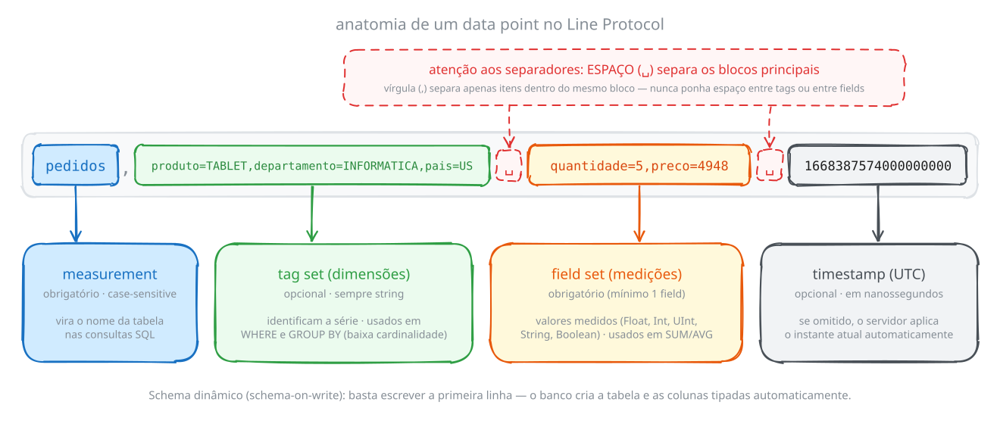
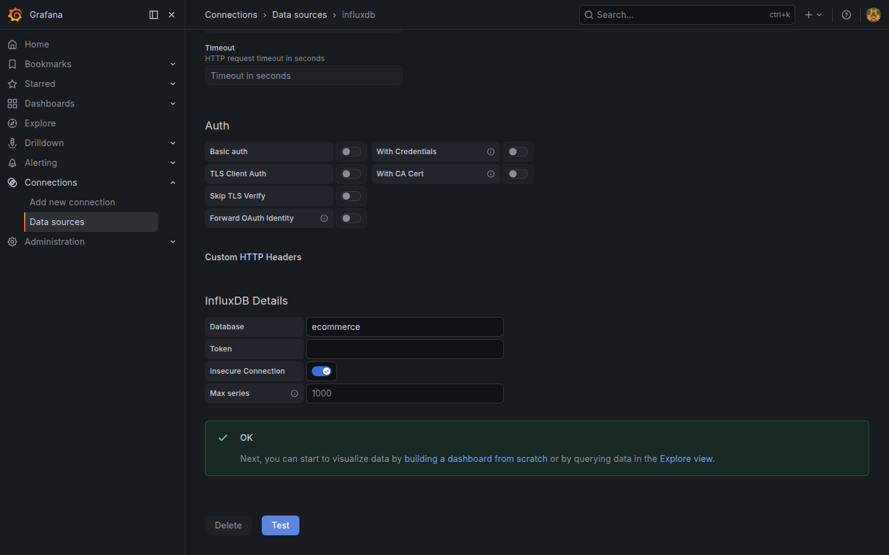
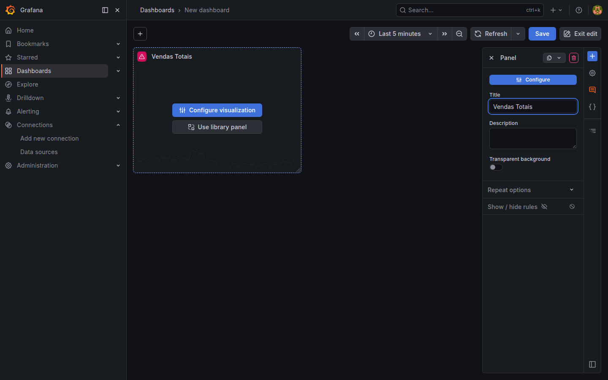
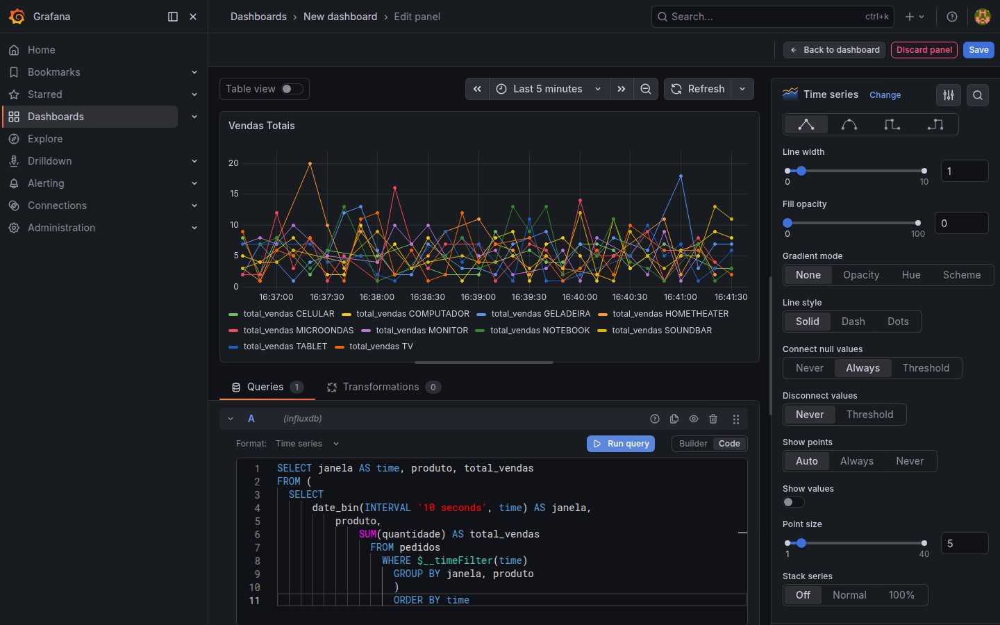
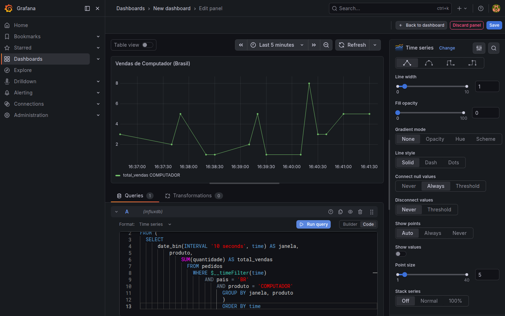
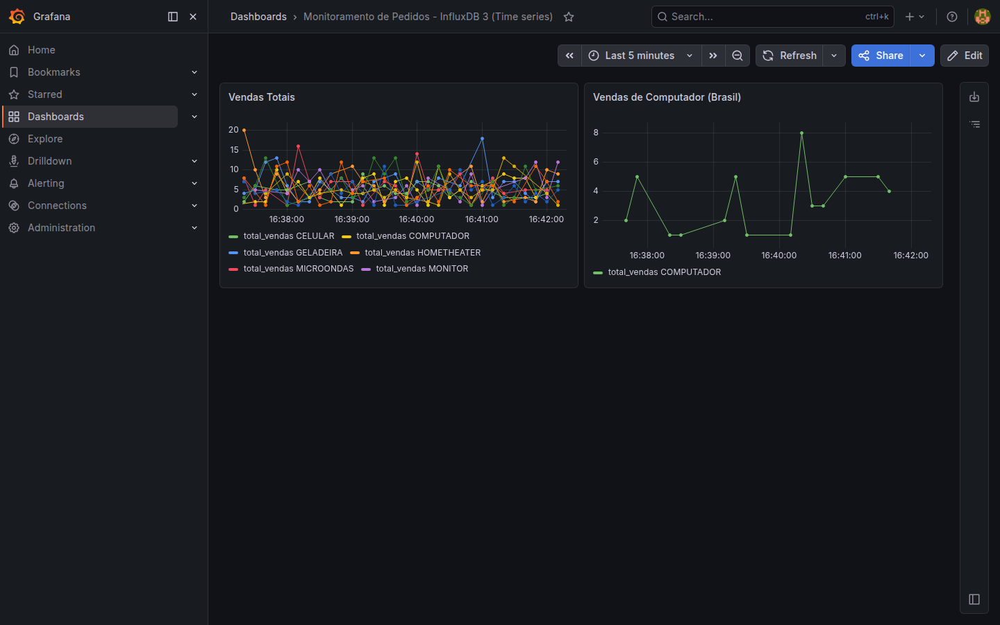

# Armazenamento de Séries Temporais com InfluxDB 3

Author: Prof. Barbosa<br>
Contact: infobarbosa@gmail.com<br>
Github: [infobarbosa](https://github.com/infobarbosa)

O objetivo deste laboratório é oferecer ao aluno uma base sólida sobre **séries temporais** e um ambiente prático de familiarização com armazenamento e consulta SQL utilizando **InfluxDB 3**.

## O que são Séries Temporais?

Antes de falar de qualquer banco de dados específico, vale consolidar o conceito de **série temporal** — que é independente do mecanismo de armazenamento.

Uma **série temporal** (*time series*) é uma sequência de observações (pontos de dados) indexadas e analisadas ao longo do tempo. Ela é usada para avaliar o comportamento de **variáveis** ao longo do tempo com o objetivo de **compreender fenômenos**, detectar anomalias ou **prever eventos futuros**.

Um **banco de dados de séries temporais (TSDB)** é um sistema de gerenciamento de banco de dados otimizado especificamente para **ingerir em alta taxa, comprimir, reter e consultar** esse tipo de dado por janelas de tempo. Embora muitos TSDBs sejam classificados fora do modelo relacional tradicional, o ecossistema moderno inclui tanto bancos construídos sobre SQL/PostgreSQL (como o TimescaleDB) quanto bancos colunares nativos com SQL padrão (como o InfluxDB 3).

### Componentes de uma série temporal

Toda pergunta de série temporal combina três elementos:

```
MEDIDA  +  FATO  +  UNIDADE DE TEMPO
```

Exemplos:
- **QUANTIDADE** *(medida)* de **VENDAS** *(fato)* realizadas por **ANO** *(unidade de tempo)*.
- **TOTAL** *(medida)* de **JOGADORES ONLINE** *(fato)* por **HORA** *(unidade de tempo)*.
- **TOTAL de bytes trafegados** *(medida)* em um **SWITCH** *(fato)* por **SEGUNDO** *(unidade de tempo)*.
- **VALOR** *(medida)* de uma **AÇÃO** negociada na bolsa *(fato)* por **DIA** *(unidade de tempo)*.

### Características fundamentais

1. **Ordem lógica pelo timestamp:** o eixo central de organização e consulta é o **tempo em que o fato ocorreu** (*event time*), e não necessariamente a ordem em que o dado chegou à rede. Em sistemas distribuídos, eventos atrasados podem chegar **fora de ordem (*out-of-order*)** — como os pedidos de **2022** que vamos gravar durante o laboratório — e ainda assim são posicionados corretamente na linha do tempo.
2. **Cadência — Séries Regulares × Irregulares:** nem toda série temporal nasce em intervalos fixos:
   - **Séries regulares (periódicas):** coletadas em cadência constante (Δt fixo), como temperatura de um motor a cada `1s`, CPU a cada `15s` ou temperatura global por mês.
   - **Séries irregulares (orientadas a eventos):** registradas somente quando o evento acontece (Δt variável), como pedidos de e-commerce, cliques ou transações financeiras. Na hora da análise, funções de agrupamento temporal como `date_bin()` reamostram esses eventos irregulares em janelas fixas (ex.: vendas a cada `10 seconds`).
3. **Escrita *append-only* e ciclo de vida:** em séries temporais, o padrão dominante é **inserir novos pontos continuamente** — raramente se executam `UPDATE` ou `DELETE` pontuais. O ciclo de vida dos dados costuma ser gerenciado por **políticas de retenção** (expiração de dados antigos) e **sumarização (*downsampling*)**.


### Exemplos práticos no mundo real

- **Varejo:** um supermercado avalia a evolução de suas vendas por dia ao longo do ano para planejar estoque e sazonalidade.
- **Automobilismo / IoT:** uma equipe de Fórmula 1 acompanha a temperatura do motor por segundo durante uma corrida.
- **Games online:** uma produtora monitora a latência do jogo por segundo à medida que mais jogadores entram simultaneamente.
- **Clima e ciência:** pesquisadores acompanham a evolução da temperatura média global por mês ao longo de décadas.
- **Redes e infraestrutura:** engenheiros estudam o tráfego de rede em switches e roteadores ao longo do dia para detectar gargalos.
- **Mercado financeiro:** analistas acompanham a variação de preço e volume negociado de uma ação minuto a minuto.

---

## Introdução ao InfluxDB 3

O [InfluxDB](https://docs.influxdata.com/influxdb3/core/) é um banco de dados de séries temporais desenvolvido pela InfluxData. Na versão 3, foi projetado com armazenamento colunar aberto e suporte nativo a **SQL padrão**, tornando a modelagem e a análise diretamente acessíveis a quem já trabalha com bancos relacionais e ferramentas de dados modernas.

### Características principais

- **Reescrito em Rust sobre o stack FDAP:** alta performance de ingestão e consulta com baixo uso de memória, apoiado em projetos abertos da Apache Software Foundation.
- **SQL padrão como linguagem principal:** consultas executadas via Apache DataFusion (mantendo também compatibilidade com **InfluxQL** para migração de consultas legadas).
- **Schema dinâmico (*schema-on-write*):** basta enviar o primeiro data point em *Line Protocol* para o banco criar automaticamente a tabela e as colunas tipadas.
- **Alta taxa de escrita *append-only* e alta cardinalidade:** graças ao formato colunar em memória (Arrow) e em disco (Parquet), lida com muito mais eficiência com dimensões de alta cardinalidade do que arquiteturas baseadas apenas em índices invertidos tradicionais — suportando métricas, eventos, logs e telemetria via OpenTelemetry.
- **Interfaces nativas modernas:** **HTTP API** (`/api/v3/write_lp`, `/api/v3/query_sql`) e **Apache Arrow Flight / FlightSQL (gRPC)** na porta `:8181`, além de CLI e bibliotecas clientes oficiais.
- **Arquitetura *cloud-native* em formato aberto:** separa computação de armazenamento persistindo arquivos **Apache Parquet** em *Object Store* (Amazon S3, GCS, Azure Blob ou disco local), permitindo reutilização direta dos dados por motores analíticos externos (DuckDB, Spark, BI).

### Onde aplicar (e quando não usar)

O InfluxDB 3 se destaca quando há **alta taxa de escrita contínua**, **consultas filtradas ou agregadas por janela de tempo** e necessidade de **formato aberto ou consultas SQL ricas**:

- **IoT e Indústria:** sensores em manufatura, energia, agronegócio, petróleo e gás, frotas e veículos conectados.
- **Observabilidade e Infraestrutura:** monitoramento de servidores, containers, bancos de dados, redes, aplicações e telemetria OpenTelemetry.
- **Analytics em Tempo Real e Finanças:** pedidos de e-commerce, cliques, jogos online, cotações de mercado, detecção de anomalias e auditoria temporal de eventos.


> **Quando NÃO usar:** evite TSDBs para sistemas transacionais (**OLTP**) com `UPDATE`/`DELETE` frequentes, cadastros relacionais ou transações ACID multi-tabela — nesses casos use um banco relacional (PostgreSQL, MySQL). Também avalie se um monitoramento puramente operacional de infraestrutura (taxas, saturação e SLOs) não é atendido de forma mais leve pelo **Prometheus** (veja o comparativo adiante).

### Panorama de Mercado (DB-Engines)

Para acompanhar a adoção de bancos de séries temporais no mercado, a referência mais usada é o **[DB-Engines Ranking — Time Series DBMS](https://db-engines.com/en/ranking/time+series+dbms)** (atualizado mensalmente). Vale lembrar que o ranking mede **popularidade** (menções técnicas, buscas, vagas de emprego e comunidade) — e **não** performance em benchmark.

Entre os principais representantes da categoria, cada ferramenta ocupa um nicho distinto:

| Banco | Perfil / Arquitetura | Linguagem principal | Onde costuma brilhar |
|---|---|---|---|
| **InfluxDB** | Colunar aberto (Rust + FDAP/Parquet na v3) | **SQL** (+ InfluxQL) | IoT, eventos em tempo real, alta cardinalidade, integração com data lakes |
| **Prometheus** | TSDB próprio (Go, Pull/scrape, chunks Gorilla) | **PromQL** | Observabilidade cloud-native, Kubernetes, métricas operacionais e alertas |
| **Kdb+** | Colunar em memória / vetorizado (proprietário) | **q** | Mercado financeiro de ultrabaixa latência (trading, tick data) |
| **TimescaleDB** | Extensão de séries temporais sobre **PostgreSQL** | **SQL** (PostgreSQL) | Quem já usa PostgreSQL e precisa cruzar séries temporais com tabelas relacionais |
| **QuestDB** | Colunar de baixa latência (Java/C++, SIMD) | **SQL** (com extensões temporais) | Ingestão altíssima em finanças, telemetria e IoT com baixa latência |
| **Apache Druid** | Banco analítico OLAP distribuído em tempo real | **SQL** | Analytics interativo em larga escala sobre streams (Kafka) e grandes volumes |

### O motor do InfluxDB 3 (por que ele é diferente)

O InfluxDB 3 foi **reescrito em Rust** sobre o chamado *stack FDAP*, todo baseado em projetos Apache:

- **F**light — [Apache Arrow Flight](https://arrow.apache.org/docs/format/Flight.html): transporte de dados colunar de alta performance (usado, por exemplo, pelo Grafana para falar SQL com o banco).
- **D**ataFusion — [Apache DataFusion](https://datafusion.apache.org/): o motor de consulta SQL.
- **A**rrow — [Apache Arrow](https://arrow.apache.org/): o formato colunar **em memória**.
- **P**arquet — [Apache Parquet](https://parquet.apache.org/): o formato colunar **em disco**.

Na prática, isso significa que os seus dados são armazenados **exatamente no mesmo formato** (Parquet) que você encontraria em um data lake — e é por isso que, ao final deste laboratório, conseguiremos abrir os arquivos internos do banco com ferramentas de análise como o **DuckDB** ([Seção 9](#9-por-dentro-do-armazenamento-parquet--arrow-hands-on)).

### Topologia esperada em produção (quem é quem e fluxo PUSH + FlightSQL)

Antes de subir o ambiente de aula, vale visualizar **em qual servidor cada componente roda em produção** e **como a informação trafega** — da escrita de cada evento até a consulta SQL no Grafana ou a leitura aberta via DuckDB:


Resumindo o fluxo informacional da esquerda para a direita:
- **Empurrado (*Push* — `HTTP POST /api/v3/write_lp`, setas laranjas):** diferente do Prometheus (que faz *Pull*), no InfluxDB 3 são as **aplicações, agentes como o Telegraf/OpenTelemetry ou scripts CLI** que iniciam a conexão e empurram eventos individuais em *Line Protocol* para o servidor.
- **Armazenamento aberto (setas azuis e verde):** o servidor grava no **WAL**, mantém o buffer recente em **Apache Arrow** (RAM) e persiste snapshots imutáveis em **Apache Parquet** no *Object Store* (Amazon S3 / GCS em produção; disco local no laboratório) — permitindo que ferramentas como **DuckDB** ou **Spark** leiam os dados diretamente sem passar pelo InfluxDB.
- **Consultado via SQL (setas azuis para o Grafana):** o **Grafana** roda em servidor separado, **não armazena dados** e consulta o InfluxDB 3 via **Arrow Flight (FlightSQL / gRPC)** na porta `:8181`, recebendo os resultados já em formato colunar Arrow.

### Padrões arquiteturais e ecossistema moderno

Em produção, o InfluxDB 3 raramente trabalha sozinho. Os três padrões abaixo resumem como ele se encaixa no ecossistema atual (substituindo ferramentas legadas de gerações antigas, como Chronograf e Kapacitor, por **Grafana**, **OpenTelemetry/Telegraf**, **Kafka + Spark/Flink** e **Object Store em Parquet**):


- **Padrão A — IoT e Infraestrutura:** agentes leves (**Telegraf** ou **OpenTelemetry Collector**) coletam métricas de sensores, servidores e bancos relacionais, agrupam em lotes e empurram (**PUSH**) para o InfluxDB 3; o **Grafana** centraliza dashboards e alertas.
- **Padrão B — Streaming em Alta Escala (separando PUSH × PULL):** eventos de negócio passam por **Apache Kafka** e processamento em streaming (**Spark Structured Streaming** ou **Apache Flink**) antes de serem gravados via **PUSH** no InfluxDB 3. Repare no detalhe arquitetural importante: quando o **Prometheus** coexiste nesse ambiente, ele **não recebe PUSH contínuo** dos microsserviços — ele faz **PULL (*scrape* periódico)** no endpoint `/metrics`, e o Grafana unifica ambas as fontes (SQL + PromQL) no mesmo painel.
- **Padrão C — Arquitetura Aberta (*Lakehouse*):** como o InfluxDB 3 persiste arquivos **Apache Parquet** no Object Store (S3/GCS), equipes de dados e ciência de dados podem ler o histórico diretamente com **DuckDB**, **Spark** ou ferramentas de BI sem competir com as consultas operacionais do banco.

### InfluxDB 3 × Prometheus (telemetria em tempo real sob alta taxa de ingestão)

Se você também cursou o laboratório de [Prometheus](https://github.com/infobarbosa/prometheus-docker-demo), vale contrastar o papel de cada solução:

| Dimensão | **InfluxDB 3 (Banco de Eventos / Séries Analíticas)** | **Prometheus (Métricas Operacionais)** |
|---|---|---|
| **O que representa cada ponto** | Um **evento individual** com seu timestamp exato (ex.: cada pedido) | Uma fotografia periódica de um contador/medidor no instante do scrape |
| **Modelo de ingestão** | **Push** (Line Protocol via HTTP POST) | **Pull** (scrape HTTP periódico; Pushgateway apenas para batch) |
| **Como o custo escala sob alta carga** | Escala com o **volume de eventos/s** ingeridos | Escala com a **cardinalidade** (nº de séries), custo `O(1)` por série mesmo a 100k req/s |
| **Armazenamento em disco** | Colunar aberto (**Apache Arrow** em RAM + **Apache Parquet** em disco) | TSDB próprio (WAL + chunks **Gorilla/XOR** + índice invertido) |
| **Linguagem de consulta** | **SQL** padrão (via Apache DataFusion) | **PromQL** (`rate`, `increase`, `histogram_quantile`) |
| **Quando escolher** | Faturamento/contagem exata entre `T1` e `T2`, auditoria, IoT, análises históricas e alta cardinalidade | Monitoramento em tempo real de ritmo (`rate`), saturação e SLOs (`p95`) com baixo custo operacional |

### Core × Enterprise (importante para este laboratório)

Este laboratório usa a imagem gratuita e open source **InfluxDB 3 Core** (`influxdb:3-core`). Vale conhecer o principal limite dela:

> ⚠️ **Sem compactação no Core.** O InfluxDB 3 **Core** foi otimizado para dados recentes: ele grava os dados em **muitos arquivos Parquet pequenos** (um ou mais por janela de tempo) e **não os reorganiza** depois. Para proteger o servidor, cada consulta pode abrir no máximo um certo número de arquivos (parâmetro `--query-file-limit`); consultas sobre períodos longos, que envolvem muitos arquivos, podem ser recusadas. O **InfluxDB 3 Enterprise** inclui um *compactor* que funde esses arquivos em blocos maiores, além de políticas avançadas de retenção, replicação e alta disponibilidade, viabilizando consultas eficientes sobre qualquer intervalo histórico.
>
> Nas primeiras versões do Core havia ainda uma janela fixa de consulta de ~72 horas; ela foi removida. Hoje, dados com timestamps antigos (como os pedidos de **2022** que escreveremos adiante) são aceitos **e** consultáveis.

## Line Protocol
<br>
O protocolo de linha (line protocol) do InfluxDB é um formato simples baseado em texto adotado para escrita de data points no banco de dados.
<br>

### Sintaxe

```
<measurement>[,<tag_key>=<tag_value>[,<tag_key>=<tag_value>]] <field_key>=<field_value>[,<field_key>=<field_value>] [<timestamp>]
``` 



Onde:
- `<measurement>` (obrigatório e case-sensitive) <br>
    - Tipo `string` que representa o nome da medida (vira o nome da tabela no SQL). 

- `<tag_key>=<tag_value>` (não obrigatório, porém case-sensitive) <br>
    - Tags representadas por pares chave-valor para o data point.<br> 
    - A relação entre chave e valor é representada pelo operador `=`.<br> 
    - Ambos chave e valor devem ser do tipo `string`.<br>
    - O protocolo suporta múltiplas ocorrências de tags.

- `<field_key>=<field_value>` (obrigatório e case-sensitive) <br>
    - Fields (campos) representados por pares chave-valor para o data point.<br>
    - Cada data point precisa ter pelo menos um field.<br>
    - Fields keys (chaves) devem ser do tipo `string`, field values (valores) podem ser dos tipos `Float`, `Integer`, `UInteger`, `String` e `Boolean`.

- `[<timestamp>]` é expresso em nanossegundos e não obrigatório.<br>
    > Caso não informado, o InfluxDB utiliza o timestamp interno do servidor.

### Tags × Fields — o conceito mais importante

A distinção entre **tags** e **fields** é central em bancos de séries temporais e determina o desempenho das consultas:

| | **Tags** | **Fields** |
|---|---|---|
| Tipo | sempre `string` | `Float`, `Integer`, `UInteger`, `String`, `Boolean` |
| Papel | **identificam a série** (metadados / dimensões) | **as medições** (os valores que variam no tempo) |
| Uso típico | `WHERE`, `GROUP BY` | `SELECT`, agregações (`SUM`, `AVG`...) |
| Exemplo no lab | `produto`, `departamento`, `pais` | `quantidade`, `preco` |

> **Cardinalidade** é o número de combinações distintas de séries (measurement + conjunto de tags). Tags com muitos valores possíveis (ex.: `id_do_pedido`, IP, e-mail) causam **alta cardinalidade** — historicamente o principal gargalo de séries temporais. Regra prática: use como tag apenas o que você vai **filtrar/agrupar**; o resto é field.

> **No InfluxDB 3 isso mudou de fundo.** O armazenamento agora é **colunar (Apache Arrow em memória, Apache Parquet em disco)**. A separação tag/field continua no Line Protocol, mas fisicamente cada tag e cada field vira uma **coluna** tipada e comprimida. Por isso o v3 tolera cardinalidade muito melhor que arquiteturas anteriores e permite **SQL padrão** sobre os dados. Vamos ver esses arquivos Parquet na [Seção 9](#9-por-dentro-do-armazenamento-parquet--arrow-hands-on).

### Schema dinâmico (*schema-on-write*)

Diferente de bancos relacionais tradicionais, no InfluxDB 3 você **não precisa executar `CREATE TABLE`** antes de gravar:

- **Criação automática:** ao escrever o primeiro data point em um *measurement*, o banco cria a tabela e todas as colunas correspondentes às tags e aos fields enviados.
- **Evolução flexível:** se um novo data point chegar com uma nova tag ou um novo field (ex.: `desconto=50`), a coluna é adicionada automaticamente ao catálogo; nas linhas em que aquela coluna não foi enviada (como a coluna `departamento` nos pedidos manuais da Seção 5), o valor fica como **`NULL`** — armazenado no Parquet com um *validity bitmap* mínimo, sem desperdiçar espaço com texto vazio.
- **Tipagem fixa após a primeira escrita:** uma vez que um field é gravado com um tipo (por exemplo `preco=2000` como `Float` ou `Integer`), escritas futuras com tipo incompatível na mesma coluna (ex.: uma string `preco="caro"`) são rejeitadas para preservar a consistência do schema colunar.

**Exemplo**:
```
pedidos,produto=GELADEIRA quantidade=1,preco=2000 1668387574000000000
```

## Laboratório

### 1. Ambiente
Este laboratório é executado em uma instância **AWS EC2** (`t3.medium`) provisionada automaticamente via **AWS CloudShell**.<br>
A instância executa dois containers Docker:
- **`influxdb-lab`**: o **code-server** (Visual Studio Code direto no navegador), o **InfluxDB 3 Core**, o **DuckDB** e o **produtor de pedidos** (veja a seção 2).
- **`grafana`**: a plataforma de visualização de dashboards, explorada na seção bônus ao final do laboratório.

Todos os comandos do tutorial são executados no terminal do code-server.

> **ATENÇÃO:**
> 1. **Região:** Utilize sempre a região **Norte da Virgínia (`us-east-1`)** no Console AWS.
> 2. **Custos:** A instância EC2 e o volume EBS consomem créditos do seu laboratório AWS Academy. Ao encerrar a aula, garanta que a instância esteja parada (**Stopped**) ou aguarde o desligamento automático da sessão.
> 3. **Não recrie a máquina para continuar o trabalho:** cada execução do `launch-lab.sh` cria uma instância **nova e vazia**, com data e hora no nome. Se a sua instância já existir, siga as instruções de [Retomando o laboratório](#retomando-o-laboratório). Se precisar mesmo recriar, encerre a anterior (**Instance state** > **Terminate instance**) para não consumir créditos.

#### Passo 1: Abrir o AWS CloudShell
1. Faça login no Console da AWS através do seu painel do AWS Academy.
2. Certifique-se de que a região selecionada no canto superior direito é **N. Virginia (`us-east-1`)**.
3. No topo do console, clique no ícone do **AWS CloudShell** (`>_`) ao lado da barra de pesquisa.
4. Aguarde o terminal do CloudShell carregar.

#### Passo 2: Executar o script de provisionamento
No terminal do CloudShell, execute:
```
curl -sS https://raw.githubusercontent.com/infobarbosa/influxdb-timeseries-demo/main/launch-lab.sh | bash
```

O script realizará de forma automatizada:
- Descoberta da VPC padrão e de uma Subnet pública.
- Criação do Security Group `lab-influxdb-sg` liberando as portas `8080` (IDE), `3000` (Grafana) e `22` (SSH).
- Lançamento de uma nova instância EC2 `lab-influxdb-timeseries-AAAA-MM-DD_HH_MI_SS` (`t3.medium`, sufixo com a data e hora da execução, Ubuntu 24.04, 20 GB gp3).
- Instalação do Docker e inicialização dos containers `influxdb-lab` e `grafana`.
- Exibição do IP público e dos links de acesso.

#### Passo 3: Acessar a IDE
1. Abra no navegador o link da IDE exibido ao final do script: `http://<IP-PUBLICO>:8080`.
2. Caso a página não responda, **aguarde de 3 a 5 minutos** para que o Docker conclua o download das imagens e atualize o navegador.
3. O code-server abrirá diretamente na IDE, sem solicitar senha.
4. Abra um terminal: menu superior (três linhas horizontais) > **Terminal** > **New Terminal**.

Verifique se o InfluxDB está no ar:
```
influxdb3 --version

```

Output esperado (a versão pode variar):
```
influxdb3 InfluxDB 3 Core, 3.12.0, revision 3ba97c65f1ee4e1f127a8266517d4d2083b7ea39
```

#### Retomando o laboratório
Se a sessão do AWS Academy expirar, a instância será parada. **Não execute o `launch-lab.sh` novamente:** ele criaria uma instância nova, sem o seu trabalho.
1. No Console AWS (`us-east-1`), acesse **EC2** > **Instances**.
2. Selecione a sua instância **`lab-influxdb-timeseries-<data e hora>`** (se houver mais de uma, a mais recente) e clique em **Instance state** > **Start instance**.
3. Aguarde o status **Running** e copie o novo **Public IPv4 address** (ele muda a cada reinício).
4. Acesse `http://<NOVO_IP_PUBLICO>:8080`. Os containers reiniciam automaticamente, os dados do InfluxDB são preservados e o produtor de pedidos volta a escrever.

### 2. O produtor de pedidos
Assim que o InfluxDB inicializa, o container `influxdb-lab` cria o banco `ecommerce` e inicia um **produtor de pedidos simulados**. A cada **2 segundos** ele escreve **3 data points** (um por país) no measurement `pedidos`, usando o Line Protocol:
```
pedidos,produto=TABLET,departamento=INFORMATICA,pais=US quantidade=5,preco=4948
```

- **Tags:** `produto`, `departamento` e `pais`.
- **Fields:** `quantidade` e `preco`.
- **Timestamp:** omitido; o InfluxDB usa o instante do servidor.

Acompanhe o log do produtor:
```
tail /var/log/lab/pedidos.log

```

Output esperado:
```
2026-10-09T21:01:22+00:00 Iniciando produtor de pedidos -> http://127.0.0.1:8181 (db=ecommerce)
```

> O produtor registra no log apenas a inicialização e eventuais falhas de escrita. Se tudo estiver bem, nenhuma outra linha aparece.

### 3. A porta do InfluxDB
O InfluxDB 3 atende na porta `8181` (HTTP API e Arrow Flight). Ela é acessível de dentro do container `influxdb-lab` (pelo terminal do code-server) e pelo container do Grafana, mas **não** fica exposta na internet.

### 4. Verificando o banco de dados

No InfluxDB 3, o equivalente ao *bucket* das versões anteriores é o **database**. O banco `ecommerce` já foi criado automaticamente na inicialização do ambiente:

```bash
influxdb3 show databases

```

Output esperado:
```
+---------------+
| iox::database |
+---------------+
| _internal     |
| ecommerce     |
+---------------+
```

> Para criar um banco manualmente, o comando é `influxdb3 create database <nome>`.

Confira que o produtor já está escrevendo:
```bash
influxdb3 query \
  --database ecommerce \
  "SELECT count(*) AS pedidos FROM pedidos"

```

> Execute o comando algumas vezes: a contagem cresce em lotes de 3 pedidos a cada 2 segundos.

---

### 5. `influxdb3 write`

O comando `influxdb3 write` escreve data points no InfluxDB via entrada padrão ou argumento direto.

#### Sintaxe

```
influxdb3 write --database <nome> "<line protocol>"
``` 

Maiores informações: https://docs.influxdata.com/influxdb3/core/reference/cli/influxdb3/write/

#### Exemplo 1 — Venda de uma geladeira
```bash
influxdb3 write \
  --database ecommerce \
  "pedidos,produto=GELADEIRA,pais=BR quantidade=1,preco=2000 1668387574000000000"

```

#### Exemplo 2 — Venda sem timestamp
> O InfluxDB usará o instante atual do servidor.
```bash
influxdb3 write \
  --database ecommerce \
  "pedidos,produto=TV,pais=US quantidade=2,preco=5000"

```

#### Exemplo 3 — Múltiplos data points
```bash
influxdb3 write \
  --database ecommerce \
  "pedidos,produto=FOGAO,pais=BR quantidade=1,preco=1000 1668426060000000000
pedidos,produto=GELADEIRA,pais=AU quantidade=1,preco=2000 1668426081000000000
pedidos,produto=LAVADORA,pais=BR quantidade=1,preco=1000 1668426093000000000
pedidos,produto=FILTRO,pais=US quantidade=1,preco=500 1668426100000000000
pedidos,produto=TV,pais=BR quantidade=1,preco=5000 1668426107000000000"

```

---

### 6. `influxdb3 query` — SQL

No InfluxDB 3, as consultas são feitas em **SQL padrão**. O measurement (`pedidos`) é a tabela, tags e fields são colunas, e o timestamp fica na coluna `time`.

#### Sintaxe

```
influxdb3 query --database <nome> "<SQL>"
```

#### Exemplo 4 — Recuperar uma amostra dos registros

```bash
influxdb3 query \
  --database ecommerce \
  "SELECT * FROM pedidos LIMIT 50"

```

**Onde:**
- `SELECT *` — retorna todas as colunas.
- `FROM pedidos` — especifica o measurement (tabela).
- `LIMIT 50` — limita a saída a 50 linhas para não inundar o terminal enquanto o produtor grava continuamente.

---

#### Exemplo 5 — Filtrar por produto

```bash
influxdb3 query \
  --database ecommerce \
  "SELECT * FROM pedidos WHERE produto = 'GELADEIRA'"

```

---

#### Exemplo 6 — Selecionar colunas específicas

```bash
influxdb3 query \
  --database ecommerce \
  "SELECT time, produto, pais, quantidade, preco FROM pedidos ORDER BY time DESC LIMIT 20"

```

---

### 7. Especificando o período

Para filtrar por intervalo de tempo, use a coluna `time` na cláusula `WHERE`.

#### Exemplo 7 — Consulta para novembro de 2022

```bash
influxdb3 query \
  --database ecommerce \
  "SELECT * FROM pedidos
   WHERE time >= '2022-11-01T00:00:00Z'
     AND time <  '2022-12-01T00:00:00Z'
   ORDER BY time"

```

Output esperado (os pedidos de 2022 escritos nos Exemplos 1 e 3):
```
+--------------+------+--------+-----------+------------+---------------------+
| departamento | pais | preco  | produto   | quantidade | time                |
+--------------+------+--------+-----------+------------+---------------------+
|              | BR   | 2000.0 | GELADEIRA | 1.0        | 2022-11-14T00:59:34 |
|              | BR   | 1000.0 | FOGAO     | 1.0        | 2022-11-14T11:41:00 |
|              | AU   | 2000.0 | GELADEIRA | 1.0        | 2022-11-14T11:41:21 |
|              | BR   | 1000.0 | LAVADORA  | 1.0        | 2022-11-14T11:41:33 |
|              | US   | 500.0  | FILTRO    | 1.0        | 2022-11-14T11:41:40 |
|              | BR   | 5000.0 | TV        | 1.0        | 2022-11-14T11:41:47 |
+--------------+------+--------+-----------+------------+---------------------+
```

> Repare que a coluna `departamento` está vazia nesses pedidos: eles foram escritos sem essa tag. No InfluxDB 3, uma tag ausente em um data point vira simplesmente um valor **nulo** naquela coluna.

---

#### Exemplo 8 — Últimos 2 minutos

```bash
influxdb3 query \
  --database ecommerce \
  "SELECT * FROM pedidos
   WHERE time >= now() - INTERVAL '2 minutes'
   ORDER BY time DESC"

```

> **Atenção:** Os data points inseridos com timestamp fixo em 2022 **não aparecerão** aqui. Apenas os inseridos sem timestamp (Exemplo 2) ou pelo produtor automático poderão aparecer.

---

#### Exemplo 9 — Últimos 2 minutos com colunas organizadas

```bash
influxdb3 query \
  --database ecommerce \
  "SELECT time, produto, pais, quantidade, preco
   FROM pedidos
   WHERE time >= now() - INTERVAL '2 minutes'
   ORDER BY time DESC"

```

---

### 8. Agregações SQL

#### Exemplo 10 — Total de vendas por produto (últimos 30 minutos)

```bash
influxdb3 query \
  --database ecommerce \
  "SELECT produto, SUM(quantidade) AS total_vendas
   FROM pedidos
   WHERE time >= now() - INTERVAL '30 minutes'
   GROUP BY produto
   ORDER BY total_vendas DESC"

```

---

#### Exemplo 11 — Vendas por produto e país

```bash
influxdb3 query \
  --database ecommerce \
  "SELECT produto, pais, SUM(quantidade) AS total_vendas
   FROM pedidos
   WHERE time >= now() - INTERVAL '30 minutes'
   GROUP BY produto, pais
   ORDER BY total_vendas DESC"

```

---

#### Exemplo 12 — Janelas de tempo de 10 segundos

A função `date_bin` divide o eixo do tempo em janelas de tamanho fixo — equivalente ao `aggregateWindow` do Flux.

```bash
influxdb3 query \
  --database ecommerce \
  "SELECT
     date_bin(INTERVAL '10 seconds', time) AS janela,
     produto,
     SUM(quantidade) AS total_vendas
   FROM pedidos
   WHERE time >= now() - INTERVAL '30 minutes'
   GROUP BY janela, produto
   ORDER BY janela"

```

---

#### Exemplo 13 — Vendas do Brasil

```bash
influxdb3 query \
  --database ecommerce \
  "SELECT produto, SUM(quantidade) AS total_vendas
   FROM pedidos
   WHERE time >= now() - INTERVAL '30 minutes'
     AND pais = 'BR'
   GROUP BY produto
   ORDER BY total_vendas DESC"

```

---

#### Exemplo 14 — Vendas de geladeira na Austrália

```bash
influxdb3 query \
  --database ecommerce \
  "SELECT time, quantidade, preco
   FROM pedidos
   WHERE produto = 'GELADEIRA'
     AND pais = 'AU'
     AND time >= now() - INTERVAL '30 minutes'
   ORDER BY time DESC"

```

---

#### Exemplo 15 — Janela de tempo fixa (ponto absoluto no tempo)

Até aqui filtramos com `now() - INTERVAL '...'` (janela **relativa**, que "anda" com o relógio). Muitas análises, porém, precisam de um intervalo **absoluto** — por exemplo, "o que foi vendido **das 18h às 19h**". Basta informar os instantes de início e fim na cláusula `WHERE`.

```bash
influxdb3 query \
  --database ecommerce \
  "SELECT
     date_bin(INTERVAL '10 minutes', time) AS janela,
     produto,
     SUM(quantidade) AS total_vendas
   FROM pedidos
   WHERE time >= '2026-07-06T18:00:00-03:00'
     AND time <  '2026-07-06T19:00:00-03:00'
   GROUP BY janela, produto
   ORDER BY janela"

```

> ⏰ **Fuso horário (leia com atenção).** A coluna `time` é **sempre armazenada em UTC**. No exemplo acima usamos o sufixo `-03:00` para dizer "18h no horário de Brasília" — o InfluxDB converte para UTC automaticamente (18h em Brasília = 21h UTC). Se preferir raciocinar direto em UTC, use o sufixo `Z`: `'2026-07-06T21:00:00Z'`. **Ajuste a data (`2026-07-06`) e a faixa de horário (`18:00`–`19:00`) para o dia e a hora em que você está executando o laboratório** — se colar sem ajustar, a consulta retornará uma tabela vazia (`++`).

> ⚠️ **Lembrete do Core:** quanto mais longo o período, mais arquivos Parquet a consulta precisa abrir (veja [Core × Enterprise](#core--enterprise-importante-para-este-laboratório)).

---

### 9. Por dentro do armazenamento: Parquet + Arrow (hands-on)

Até aqui usamos o InfluxDB como uma "caixa preta". Nesta seção vamos **abrir a caixa** e olhar como os dados ficam gravados em disco — e a boa notícia é que eles estão em **Apache Parquet**, o mesmo formato colunar dos data lakes. Vamos inclusive ler esses arquivos com o **DuckDB**, sem passar pelo InfluxDB.

#### 9.1. O caminho do dado: WAL → Parquet

Quando você escreve um data point, ele **não** vai direto para um arquivo Parquet. O fluxo é:

1. **WAL** (*Write-Ahead Log*): gravação imediata e sequencial, para durabilidade e recuperação de falhas.
2. **Buffer em memória**: os dados ficam em **Apache Arrow** (colunar, em RAM) e já podem ser consultados.
3. **Persistência (snapshot)**: periodicamente o buffer é escrito como **arquivos Parquet** imutáveis no *object store* (aqui, o disco local).


> 🧪 **Ajuste didático deste laboratório.** Por padrão, o Core só gera Parquet após acumular **600 arquivos de WAL** (~10 min). Para não esperarmos, a imagem do laboratório define `INFLUXDB3_WAL_FILES_PER_SNAPSHOT=10` e `INFLUXDB3_GEN1_DURATION=1m`, fazendo o Parquet aparecer em segundos. **Nunca use esses valores em produção** — eles geram muitos arquivos pequenos.

Como o produtor de pedidos está escrevendo desde a inicialização do ambiente, os arquivos já existem. Explore a árvore de arquivos do banco:

```bash
find /var/lib/influxdb3 -maxdepth 3 -type d

```

Você verá três diretórios importantes dentro de `/var/lib/influxdb3/demo/` (`demo` é o `--node-id`):
- **`wal/`** — os arquivos `.wal` (log de escrita).
- **`catalog/`** — os metadados (bancos, tabelas, colunas, localização dos arquivos).
- **`dbs/`** — os **arquivos Parquet** com os dados de fato.

#### 9.2. Localizando os arquivos Parquet

```bash
find /var/lib/influxdb3 -name "*.parquet" | sort

```

Repare que aparecem **vários arquivos**, e no padrão do caminho — é assim que o InfluxDB 3 **particiona** os dados fisicamente, por **data**:

```
dbs/<id-do-database>/<id-da-tabela>/<data>/<hora-minuto>/<arquivo>.parquet
```

Por exemplo, `dbs/1/0/2026-10-09/21-01/0000000019.parquet`: o database e a tabela aparecem como **identificadores numéricos**, mantidos no catálogo (`catalog/`). A tabela de sistema `system.parquet_files` relaciona cada arquivo à sua tabela:

```bash
influxdb3 query \
  --database ecommerce \
  "SELECT table_name, path, row_count FROM system.parquet_files ORDER BY path LIMIT 5"

```

> 🔎 Se você executou os Exemplos 1 e 3 (com timestamp de **2022**), vai notar partições `.../2022-11-14/...` **separadas** das partições de hoje. Cada partição vira um ou mais arquivos Parquet independentes. Guarde essa ideia: **os dados estão espalhados em muitos arquivos**, não em um só.

#### 9.3. Copiando os arquivos para a sua pasta de trabalho

Como os dados estão **espalhados em vários arquivos** (um ou mais por partição de data), não faz sentido copiar só um — vamos trazer a **árvore inteira** `dbs/` para a pasta de trabalho. Assim analisamos uma cópia estável, enquanto o produtor continua escrevendo no banco:

```bash
rm -rf ./dbs && cp -r /var/lib/influxdb3/demo/dbs ./dbs
find dbs -name '*.parquet'

```

> ⚠️ **Não use `find ... | head -1`** para escolher "um arquivo". Ele pega o **primeiro** da lista, que costuma ser justamente uma partição de **2022** — um arquivo com **uma única linha** (o data point do Exemplo 1). Você teria a falsa impressão de que "cada Parquet tem só um registro". A forma correta é ler **todos os arquivos de uma vez** com um *glob* recursivo, como faremos a seguir.

#### 9.4. O DuckDB

O [DuckDB](https://duckdb.org/) é um banco analítico embarcado (um único binário) que lê Parquet nativamente e roda **SQL** — perfeito para inspecionar nossos arquivos. Ele já vem instalado no ambiente do laboratório:

```bash
duckdb --version

```

> **Alternativas:** `parquet-tools` (Python) ou `pqrs` (CLI em Rust) também inspecionam Parquet, mas o DuckDB permite rodar SQL diretamente.

#### 9.5. Lendo TODOS os dados sem o InfluxDB

O `**` faz o DuckDB varrer o diretório **recursivamente**, lendo todos os Parquet de todas as partições de uma vez — exatamente como uma engine de data lake faria:

```bash
duckdb -c "SELECT COUNT(*) AS total, MIN(time) AS mais_antigo, MAX(time) AS mais_recente
           FROM read_parquet('dbs/**/*.parquet');"

```

Note que aparece de tudo — inclusive o ponto de **2022** convivendo com os dados de hoje. O DuckDB lê os arquivos diretamente: **o InfluxDB nem precisa estar rodando**. Isso ilustra o valor de um formato aberto — seus dados não ficam presos ao banco.

```bash
duckdb -c "SELECT * FROM read_parquet('dbs/**/*.parquet') ORDER BY time DESC LIMIT 10;"

```

Agora dá para entender por que "pegar um arquivo só" engana. Veja **quantas linhas há em cada arquivo**:

```bash
duckdb -c "SELECT regexp_replace(file_name, '^(.*/)?dbs/', '') AS arquivo, num_rows
           FROM parquet_file_metadata('dbs/**/*.parquet')
           ORDER BY arquivo;"

```

Você verá os arquivos das partições de **2022 com apenas 1 a 5 linhas**, e os arquivos de hoje com dezenas de linhas cada. Cada arquivo cobre uma **partição de tempo** (data/janela). Muitos arquivos pequenos são o efeito do nosso ajuste didático (`WAL_FILES_PER_SNAPSHOT=10`); em produção, o *compactor* do InfluxDB Enterprise junta esses arquivinhos em blocos maiores — o clássico problema dos *"small files"*.

#### 9.6. O schema colunar e tipado

```bash
duckdb -c "DESCRIBE SELECT * FROM read_parquet('dbs/**/*.parquet');"

```

Note que cada tag (`produto`, `departamento`, `pais`) e cada field (`quantidade`, `preco`) virou uma **coluna tipada**, e o `time` é um `TIMESTAMP_NS`. Compare com o schema físico do Parquet (escolhemos um arquivo qualquer para inspecionar a estrutura interna):

```bash
duckdb -c "SELECT DISTINCT name, type, logical_type, repetition_type
           FROM parquet_schema('dbs/**/*.parquet');"

```

Você verá as tags como `BYTE_ARRAY` com `StringType()` e o `time` como `INT64` com `TimestampType(... NANOS ...)` — além de uma chave `arrow_schema`, que é o schema Apache Arrow embutido em cada arquivo.

#### 9.7. Compressão e *encoding* — o coração do colunar

Aqui está o conceito de bancos colunares em ação. Cada coluna é comprimida **independentemente**, com o *encoding* mais adequado ao seu conteúdo:

```bash
duckdb -c "
SELECT
  path_in_schema AS coluna,
  any_value(compression) AS compressao,
  any_value(encodings)   AS encodings,
  SUM(total_uncompressed_size) AS bruto,
  SUM(total_compressed_size)   AS comprimido
FROM parquet_metadata('dbs/**/*.parquet')
GROUP BY coluna;"

```

Observe:
- **`compressao = ZSTD`** em todas as colunas.
- **`RLE_DICTIONARY`** (dictionary encoding): o Parquet guarda um dicionário com os valores distintos da coluna e substitui cada valor por um pequeno índice inteiro. Nas tags `produto`, `departamento` e `pais`, que têm **poucos valores distintos** (baixa cardinalidade), o dicionário é minúsculo e os índices se repetem muito. É por isso que, em séries temporais, **tags de baixa cardinalidade comprimem muito bem** — e por que alta cardinalidade dói.
- **Compressão só compensa com volume.** Com os pouquíssimos dados deste laboratório, `comprimido` pode até ficar **maior** que `bruto` em algumas colunas — é o custo fixo (overhead) do ZSTD e dos dicionários em páginas minúsculas. Deixe o produtor rodar por alguns minutos, atualize a cópia local (`rm -rf ./dbs && cp -r /var/lib/influxdb3/demo/dbs ./dbs`), repita a consulta e observe a razão `comprimido/bruto` **cair** conforme o volume cresce. Esse é justamente o regime em que o formato colunar brilha.

Uma visão geral, arquivo a arquivo (linhas e *row groups*):

```bash
duckdb -c "SELECT regexp_replace(file_name, '^(.*/)?dbs/', '') AS arquivo, num_rows, num_row_groups
           FROM parquet_file_metadata('dbs/**/*.parquet')
           ORDER BY arquivo;"

```

#### 9.8. Rodando análises direto no Parquet

Como é SQL, dá para agregar sobre **todos os arquivos** sem o InfluxDB:

```bash
duckdb -c "
SELECT produto, COUNT(*) AS n, SUM(quantidade) AS total, ROUND(AVG(preco),2) AS preco_medio
FROM read_parquet('dbs/**/*.parquet')
GROUP BY produto
ORDER BY total DESC;"

```

> 💡 **Desafio (para casa):** compare o tamanho de um data point em **Line Protocol** (texto, ~60 bytes) com o custo por linha no Parquet comprimido (`SUM(total_compressed_size) / SUM(num_rows)`). Discuta por que o formato colunar comprimido é a base de praticamente todos os motores analíticos modernos (InfluxDB 3, ClickHouse, DuckDB, Spark, BigQuery...).

---

## HTTP API
<br>

O InfluxDB 3 disponibiliza os endpoints `/api/v3/write_lp` (escrita) e `/api/v3/query_sql` (consulta SQL).

### Escrita

```bash
curl -XPOST "http://localhost:8181/api/v3/write_lp?db=ecommerce&precision=s" \
  --header "Content-Type: text/plain; charset=utf-8" \
  --data-raw 'pedidos,produto=SANDUICHEIRA,pais=BR quantidade=1,preco=200'
```

### Consulta SQL via HTTP

```bash
curl -G "http://localhost:8181/api/v3/query_sql" \
  --data-urlencode "db=ecommerce" \
  --data-urlencode "q=SELECT * FROM pedidos ORDER BY time DESC LIMIT 10"
```

Ou via POST com JSON:

```bash
curl -XPOST "http://localhost:8181/api/v3/query_sql" \
  --header "Content-Type: application/json" \
  --data '{"db": "ecommerce", "q": "SELECT produto, SUM(quantidade) AS total FROM pedidos GROUP BY produto"}'
```

---

## Bônus: Grafana

O Grafana é uma plataforma open source de visualização amplamente usada para criar dashboards. Ele já está disponível como parte do ambiente deste laboratório.

### Acessando o Grafana

- Abra o navegador e acesse `http://<IP-PUBLICO>:3000` (o mesmo IP da IDE, exibido ao final do `launch-lab.sh`).
- Usuário: `admin` | Senha: `admin` (se aparecer a tela solicitando troca de senha no primeiro acesso, clique em **Skip**).

### Datasource já configurado (SQL via FlightSQL)

O datasource do InfluxDB já está configurado automaticamente via provisionamento — o `launch-lab.sh` entrega ao Grafana um arquivo de configuração (equivalente ao [`grafana-datasource.yaml`](grafana-datasource.yaml) deste repositório), lido na inicialização. Não é necessário nenhuma configuração manual na interface.

Ele está configurado no modo **SQL**, consistente com o restante do laboratório. Por baixo dos panos, o Grafana conversa com o InfluxDB 3 via **Arrow Flight (gRPC)** — o mesmo protocolo *FlightSQL* mencionado na [introdução](#o-motor-do-influxdb-3-por-que-ele-é-diferente) — recebendo os resultados já em formato colunar Arrow.

Para confirmar, acesse **Connections > Data sources > influxdb**, role até o final da página e clique em **Test**: você verá o aviso verde `OK`.



> **Curiosidade:** o InfluxDB 3 também aceita **InfluxQL** (linguagem legada do v1/v2) por compatibilidade, via `/api/v3/query_influxql`. Optamos por **SQL** aqui para manter um único dialeto no laboratório inteiro. Se um dia você vir dashboards antigos com `GROUP BY time(10s)`, isso é InfluxQL — o equivalente em SQL é o `date_bin()` que já usamos.

### Criando um painel simples

1. No menu lateral esquerdo, clique em **Dashboards**.
2. Clique em **New > New dashboard** (ou **+ Create dashboard**).
3. No menu lateral direito (**Add**), na seção **Panel**, clique no **`+`**.
4. No menu lateral direito, no campo **Title**, escreva `Vendas Totais`.
5. Para configurar o novo painel você pode:
   - a. Clicar no botão azul **Configure visualization** no centro do painel, ou
   - b. Clicar no botão azul **Configure** acima de **Title**.



6. A tela agora está dividida em:
   - parte superior: o preview do painel;
   - parte inferior: duas abas **Queries** e **Transformations** (mantenha a aba **Queries** ativada).
7. Em **Data source**, mantenha **influxdb**.
8. Combo **Format**: altere de **Table** para **Time series**.
9. Ao lado direito do botão azul **Run query**, clique em **Code**.
10. Copie a consulta a seguir e cole no editor de código:
```sql
SELECT janela AS time, produto, total_vendas
FROM (
  SELECT
    date_bin(INTERVAL '10 seconds', time) AS janela,
    produto,
    SUM(quantidade) AS total_vendas
  FROM pedidos
  WHERE $__timeFilter(time)
  GROUP BY janela, produto
)
ORDER BY time
```
11. Clique em **Run query**.
12. No topo, abra o seletor de período e escolha **Last 5 minutes**.
13. No painel direito (**Suggestions**), clique no card de visualização **Time series** para abrir as opções do gráfico; role até **Connect null values** e marque **Always**.
14. Ainda no mesmo painel, role até a seção **Standard options** e escreva `0` (zero) na caixa **No value**.



15. No topo à direita, clique em **Back to dashboard** (você também pode clicar em **Save** para salvar o progresso).

> A macro `$__timeFilter(time)` é substituída pelo Grafana pelo intervalo de tempo selecionado no dashboard (canto superior direito).

> ⚠️ **Por que uma subquery em vez de `date_bin(...) AS time` direto?** A tabela `pedidos` já tem uma coluna nativa chamada `time`. Se o alias do `date_bin` também se chamar `time` e a mesma consulta tiver `GROUP BY time`, existe uma ambiguidade de nomes: o SQL padrão (e o DataFusion, motor do InfluxDB 3) resolve isso priorizando a **coluna de origem** sobre o **alias de saída** — ou seja, agruparia pelo timestamp bruto, em nanossegundos, o que equivale a **não agregar nada** (cada linha vira seu próprio grupo). O erro é silencioso: a consulta roda sem falhar, só devolve o dado errado.
>
> A subquery evita isso separando as duas responsabilidades: a agregação acontece por dentro, usando um nome sem conflito (`janela`); a camada externa só **renomeia** o resultado já correto para `time` — nome exigido pelo Grafana quando o **Format** do painel está em **Time series** (é assim que ele identifica o eixo do tempo e separa uma linha por valor de `produto`). Com **Format: Table** essa exigência de nome não existe, mas também não há a separação em múltiplas séries — por isso o passo 8 pede explicitamente **Time series**.

### Segundo painel

De volta ao dashboard, clique no ícone **`+`** no topo do menu lateral direito (**Add**) e em **Panel > `+`**. Execute as mesmas etapas do primeiro painel (por exemplo, com **Title** `Vendas de Computador (Brasil)`), mas desta vez inclua a consulta a seguir:
```sql
SELECT janela AS time, produto, total_vendas
FROM (
  SELECT
    date_bin(INTERVAL '10 seconds', time) AS janela,
    produto,
    SUM(quantidade) AS total_vendas
  FROM pedidos
  WHERE $__timeFilter(time)
    AND pais = 'BR'
    AND produto = 'COMPUTADOR'
  GROUP BY janela, produto
)
ORDER BY time
```



Clique em **Back to dashboard**, depois em **Save** no topo à direita (dê um nome como `Monitoramento de Pedidos - InfluxDB 3`) e em **Exit edit** para visualizar o dashboard completo:



> 🔎 **Como ler o dashboard:** o painel à esquerda consolida a evolução de vendas de todos os 10 produtos em janelas de 10 segundos (com separação automática por série graças ao `Format: Time series`); o painel à direita aplica um recorte analítico específico (`pais = 'BR'` e `produto = 'COMPUTADOR'`), mostrando como o SQL do InfluxDB 3 permite filtrar dimensões diretamente sobre os dados individuais em tempo real.

---

## Referências para aprofundamento

Sugestões para continuar os estudos, organizadas por tema.

### InfluxDB 3
- [Documentação oficial — InfluxDB 3 Core](https://docs.influxdata.com/influxdb3/core/) — ponto de partida.
- [Get started with InfluxDB 3 Core](https://docs.influxdata.com/influxdb3/core/get-started/) — escrita, consulta e configuração passo a passo.
- [Line Protocol — referência](https://docs.influxdata.com/influxdb3/core/reference/line-protocol/) — a sintaxe completa de escrita.
- [Referência de SQL do InfluxDB 3](https://docs.influxdata.com/influxdb3/core/reference/sql/) e [de InfluxQL](https://docs.influxdata.com/influxdb3/core/reference/influxql/) — os dois dialetos suportados.
- [CLI `influxdb3`](https://docs.influxdata.com/influxdb3/core/reference/cli/influxdb3/) — todos os subcomandos (`write`, `query`, `create`, `serve`...).
- [Blog — InfluxDB 3.0 System Architecture](https://www.influxdata.com/blog/influxdb-3-0-system-architecture/) — como o motor funciona por dentro (ingester, compactor, catalog, object store).
- [Diferenças entre Core e Enterprise](https://docs.influxdata.com/influxdb3/core/#core-vs-enterprise).

### O stack FDAP (Apache) e formatos colunares
- [Apache Arrow](https://arrow.apache.org/) — o formato colunar em memória.
- [Apache Parquet](https://parquet.apache.org/docs/) — o formato colunar em disco; veja em especial *encodings* e *compression*.
- [Apache DataFusion](https://datafusion.apache.org/) — o motor de consulta SQL em Rust usado pelo InfluxDB 3.
- [Apache Arrow Flight & FlightSQL](https://arrow.apache.org/docs/format/FlightSql.html) — o protocolo de transporte colunar usado pelo Grafana.
- [InfoQ — Rebuilding InfluxDB 3 in Apache Arrow and Rust](https://www.infoq.com/articles/timeseries-db-rust/) — a história técnica da reescrita.
- [DuckDB — documentação](https://duckdb.org/docs/) e o guia [Reading and Writing Parquet](https://duckdb.org/docs/data/parquet/overview).

### Séries temporais e bancos colunares (conceitos)
- [DB-Engines Ranking — Time Series DBMS](https://db-engines.com/en/ranking/time+series+dbms) — panorama atualizado de popularidade de bancos de séries temporais.
- Jensen, Pedersen & Thomsen — *[Time Series Management Systems: A Survey](https://arxiv.org/abs/1710.01792)* (survey acadêmico).
- Bader, Kopp & Becker — *[Survey and Comparison of Open Source Time Series Databases](https://www.researchgate.net/publication/315838456_Survey_and_Comparison_of_Open_Source_Time_Series_Databases)* (ResearchGate).
- Di Martino et al. — *[A Comparison of Time Series Databases for Storing Water Quality Data](https://www.researchgate.net/publication/332482421_A_Comparison_of_Time_Series_Databases_for_Storing_Water_Quality_Data)* (ResearchGate).
- Dunning & Friedman — *[Time Series Databases](https://www.researchgate.net/publication/286732446_Time_Series_Databases)* (ResearchGate).
- PUC-Rio — *[Conceitos Fundamentais de Séries Temporais (PDF)](https://www.maxwell.vrac.puc-rio.br/4244/4244_5.PDF)* (base teórica).
- Abadi et al. — *[The Design and Implementation of Modern Column-Oriented Database Systems](https://stratos.seas.harvard.edu/files/stratos/files/columnstoresfntdbs.pdf)* (leitura de referência sobre colunar).
- [Awesome Time Series Database](https://github.com/xephonhq/awesome-time-series-database) — panorama de ferramentas do ecossistema.

### Visualização e ecossistema
- [Grafana — data source oficial do InfluxDB v3](https://www.influxdata.com/blog/official-influxdb-v3-data-source-grafana-released/).
- [Grafana — documentação do data source InfluxDB](https://grafana.com/docs/grafana/latest/datasources/influxdb/).
- [Telegraf](https://docs.influxdata.com/telegraf/) — agente de coleta de métricas, o companheiro natural do InfluxDB para ingestão em produção.

---

## Apêndice: Execução Local

Fora do horário de aula, é possível executar o mesmo ambiente em qualquer máquina (ou provedor de nuvem) com Docker disponível. A imagem é publicada para `linux/amd64` e `linux/arm64` (inclusive Macs com Apple Silicon).

Faça o clone deste repositório e inicialize os containers com o `compose.yaml` disponível na raiz do projeto:
```
git clone https://github.com/infobarbosa/influxdb-timeseries-demo.git
cd influxdb-timeseries-demo
docker compose up -d

```

Acesse a IDE em `http://localhost:8080` e o Grafana em `http://localhost:3000`, e siga o tutorial a partir do [Passo 3](#passo-3-acessar-a-ide).

Para encerrar e remover os containers (os dados do InfluxDB serão descartados):
```
docker compose down

```

---

## Parabéns!

Parabéns por concluir o laboratório de Armazenamento de Séries Temporais com InfluxDB 3! Você aprendeu como utilizar o InfluxDB 3 para armazenar e consultar dados de séries temporais usando SQL padrão. Continue praticando e explorando as funcionalidades do InfluxDB para aprimorar ainda mais seus conhecimentos.

Se tiver dúvidas ou sugestões, sinta-se à vontade para entrar em contato.

Bom trabalho e até a próxima!

Prof. Barbosa
